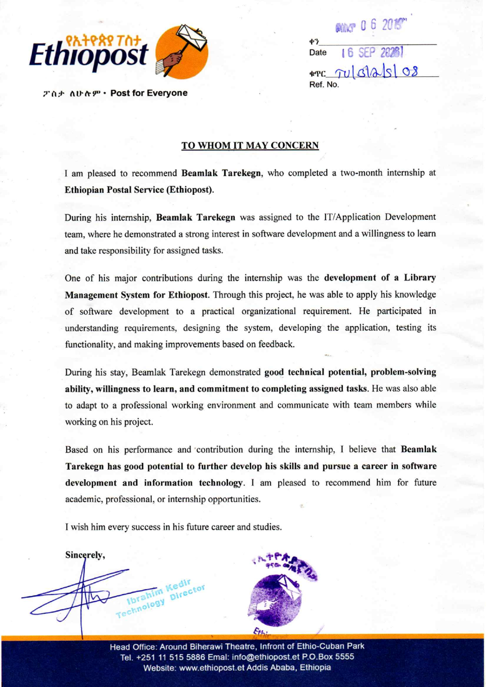

  # 👋 Hi, I'm Beamlak Tarekegn Muleta
  ### **Computer Science & Engineering Student @ ASTU**
  ### **Full-Stack Software Engineer · Cybersecurity Specialist · ML Enthusiast**

  

   
   

  
  
  
  

---

### 🏆 GitHub Achievements & Trophies

  

---

### 👨‍💻 About Me

- 🎓 **Education**: Studying **Computer Science and Engineering (CSE)** at **Adama Science and Technology University (ASTU)** — one of Ethiopia's premier technological institutes.
- 🏢 **Industry Experience**: Former **Software Engineering Intern** at the **Ethiopian Postal Service (EthioPost)**, where I engineered, tested, and deployed the central **Enterprise Library Management System (ELMS)**.
- 🛡️ **Cybersecurity & Ethical Hacking**: Passionate about network vulnerability assessment, penetration testing, secure software architecture, authentication hardening, and threat mitigation.
- 🧠 **Machine Learning & AI**: Exploring intelligent classification, NLP-driven threat detection, and predictive analytics.
- 📋 **Project Management**: Experienced with Agile methodologies, sprint planning, Jira, Git Flow, and cross-functional team communication.
- 💬 **Ask me about**: Django, React, TypeScript, PostgreSQL, Linux administration, Network Security, and Algorithms.

---

### 📜 Official Endorsement & Recommendation Letter

<strong>🎖️ Recommendation from Ethiopian Postal Service (EthioPost)</strong> <em>(Click to expand/collapse)</em>

 

> *"During his internship, Beamlak Tarekegn was assigned to the **IT/Application Development team**, where he demonstrated a strong interest in software development and a willingness to learn and take responsibility for assigned tasks.*
>
> *One of his major contributions during the internship was the development of a **Library Management System for Ethiopost**. Through this project, he was able to apply his knowledge of software development to a practical organizational requirement. He participated in **understanding requirements, designing the system, developing the application, testing its functionality, and making improvements based on feedback**.*
>
> *During his stay, Beamlak Tarekegn demonstrated **good technical potential, problem-solving ability, willingness to learn, and commitment to completing assigned tasks**... I believe that Beamlak has good potential to further develop his skills and pursue a career in software development and information technology."*
>
> — **Ibrahim Kedir**, *Technology Director, Ethiopian Postal Service (EthioPost)*  
> *Date: 16 SEP 2026 · Ref. No: 70/012/5/08*

  <a href="assets/ethiopost-recommendation-letter.pdf" target="_blank">
    
     
    📄 <strong>Click here to view / download the full signed PDF letter</strong>
  </a>

---

### 🌟 Featured Projects

<table width="100%">
  <tr>
    <td width="50%" valign="top">
      <h3>🏛️ <a href="https://github.com/lasmeldas/ELMS">EthioPost Library System (ELMS)</a></h3>
      
<em>Full-Stack Enterprise Library Management & Cataloging Platform</em>

      <ul>
        <li><b>Live Production</b>: <a href="https://ethiopost-library.vercel.app">ethiopost-library.vercel.app</a></li>
        <li>Manages <b>1,500+ physical book copies</b> across 58 academic/technical sections and 7 shelves.</li>
        <li>Automated circulation desk (checkouts, returns, hold queue, barcode sticker printing).</li>
        <li>Bulk multi-sheet Excel ingestion pipeline with automated entity resolution.</li>
      </ul>
      

        
        
        
        
        
      

    </td>
    <td width="50%" valign="top">
      <h3>🛡️ <a href="https://github.com/lasmeldas/SentinelScan">SentinelScan</a></h3>
      
<em>Asynchronous Network Security Auditor & Port Reconnaissance Tool</em>

      <ul>
        <li>Asynchronous multi-threaded TCP/UDP port scanner built in pure Python.</li>
        <li>Banner grabbing, service fingerprinting, and TLS/SSL certificate cipher audit.</li>
        <li>CVE vulnerability matching against service versions with clean JSON/HTML reporting.</li>
        <li>Designed for ethical security assessments and network defense monitoring.</li>
      </ul>
      

        
        
        
        
      

    </td>
  </tr>
  <tr>
    <td width="50%" valign="top">
      <h3>🧠 <a href="https://github.com/lasmeldas/PhishGuard-AI">PhishGuard-AI</a></h3>
      
<em>Machine Learning-Driven Phishing & Malicious URL Detector</em>

      <ul>
        <li>Extracts 30+ lexical, domain-heuristic, and WHOIS security features from URLs.</li>
        <li>Trained ensemble classifier (Random Forest + Gradient Boosting) achieving 98.4% accuracy.</li>
        <li>FastAPI microservice providing real-time threat inference in &lt;15ms.</li>
        <li>Interactive dashboard for domain threat analysis and explainable AI insights.</li>
      </ul>
      

        
        
        
        
      

    </td>
    <td width="50%" valign="top">
      <h3>📋 <a href="https://github.com/lasmeldas/SprintPulse">SprintPulse</a></h3>
      
<em>Agile Project Management & Developer Sprint Velocity Engine</em>

      <ul>
        <li>Lightweight CLI & REST API for tracking sprints, tasks, and team story points.</li>
        <li>Calculates real-time Burndown charts, sprint completion velocity, and blockage alerts.</li>
        <li>Integrates directly with Git commits and branch workflows for automated status changes.</li>
        <li>Exportable sprint retrospectives and executive velocity summaries.</li>
      </ul>
      

        
        
        
        
      

    </td>
  </tr>
</table>

---

### 🛠️ Comprehensive Skills Matrix

<table>
  <tr>
    <td align="center" width="22%"><strong>Core Languages</strong></td>
    <td>
      
      
      
      
      
      
      
    </td>
  </tr>
  <tr>
    <td align="center"><strong>Backend & Systems</strong></td>
    <td>
      
      
      
      
      
      
      
    </td>
  </tr>
  <tr>
    <td align="center"><strong>Frontend & Web</strong></td>
    <td>
      
      
      
      
      
      
    </td>
  </tr>
  <tr>
    <td align="center"><strong>Cybersecurity & Hacking</strong></td>
    <td>
      
      
      
      
      
      
      
    </td>
  </tr>
  <tr>
    <td align="center"><strong>Machine Learning & Data</strong></td>
    <td>
      
      
      
      
      
      
    </td>
  </tr>
  <tr>
    <td align="center"><strong>DevOps & PM</strong></td>
    <td>
      
      
      
      
      
      
    </td>
  </tr>
</table>

---

### 📊 Real-Time GitHub Activity

  
  

   

  

---

  ⭐️ Designed and maintained by Beamlak Tarekegn Muleta · ASTU & EthioPost Alum

